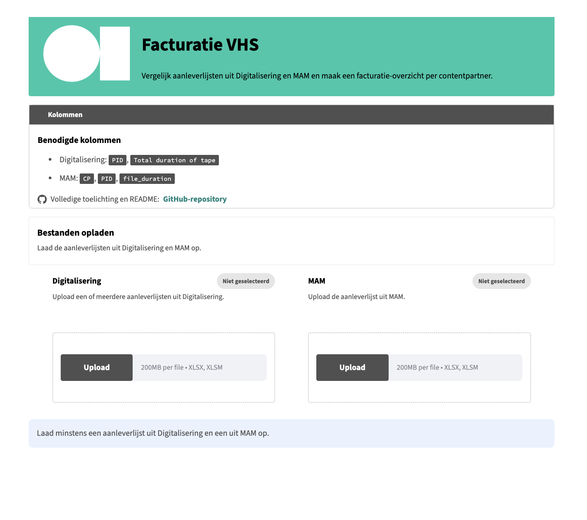
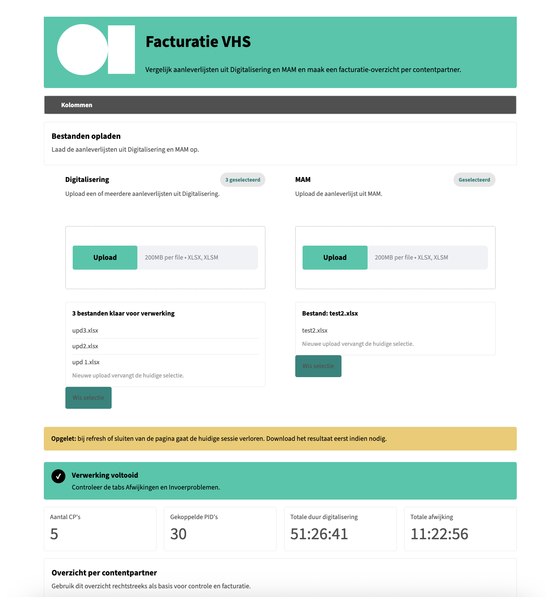

# Facturatie VHS

Deze app is bedoeld voor het vergelijken van aanleverlijsten uit `Digitalisering` en `MAM`, zodat je snel een bruikbaar facturatie-overzicht per contentpartner krijgt.

Op het scherm houden we de uitleg bewust kort. De volledige werkwijze en technische aannames staan hier in de `README`.

## Projectcontext

Deze tool is uitgewerkt voor een specifieke workflow binnen meemoo en is afgestemd op de verwachte Excel-structuren, kolomnamen en gewenste resultaten van deze case. De toepassing is daarom geen algemene oplossing voor willekeurige spreadsheets zonder verdere configuratie.

Tegelijk is het project een praktisch voorbeeld van hoe je:

- gegevens uit meerdere Excel-bestanden samenbrengt
- records uit verschillende bronnen koppelt op een gemeenschappelijke sleutel
- duurwaarden in verschillende formaten normaliseert en optelt
- verschillen per `PID` berekent en per contentpartner groepeert
- invoerproblemen zichtbaar maakt en de resultaten opnieuw naar Excel exporteert

## Interface en werkwijze

De gebruikersinterface is verder verfijnd voor een duidelijke en efficiënte kwartaalverwerking.

- voor de verwerking zijn de uploadzones voor `Digitalisering` en `MAM` duidelijk van elkaar gescheiden
- de geselecteerde bestanden en hun status blijven zichtbaar
- na de verwerking toont de app direct het aantal contentpartners, het aantal gekoppelde PID's, de totale duur van de digitalisering en de totale afwijking
- het overzicht per contentpartner kan daarna als Excel-bestand worden gedownload

De interface bevat alleen de informatie die tijdens de verwerking nodig is. Uitgebreide toelichting over invoerformaten, berekeningen en uitzonderingen staat in deze `README`.

### Startscherm



### Verwerking en resultaat



## Doel

Gebruik de app wanneer je:

- een of meerdere aanleverlijsten uit `Digitalisering` krijgt
- een aanleverlijst uit `MAM` krijgt
- op basis van `PID` wilt controleren welke records overeenkomen
- de duur uit beide bronnen wilt vergelijken
- een overzicht per `CP` nodig hebt voor controle en facturatie

## Verwachte bestanden

### Digitalisering

De app verwacht in elk Digitalisering-bestand minstens deze kolommen:

- `PID`
- `Total duration of tape`

Je mag meerdere Excel-bestanden tegelijk uploaden. De app voegt ze eerst samen en behandelt ze daarna als een geheel.

### MAM

De app verwacht in het MAM-bestand minstens deze kolommen:

- `CP`
- `PID`
- `file_duration`

## Hoe de koppeling werkt

- `PID` is het koppelveld tussen beide bronnen
- als dezelfde `PID` meerdere keren voorkomt in `Digitalisering`, worden de duurwaarden opgeteld
- als dezelfde `PID` meerdere keren voorkomt in `MAM`, worden de duurwaarden opgeteld
- als een `PID` in `MAM` aan meerdere `CP`-waarden hangt, markeert de app dit als `CP-conflict`

## Wat de app berekent

Per gekoppelde `PID`:

- duur uit `Digitalisering`
- duur uit `MAM`
- verschil tussen beide

Daarna maakt de app een overzicht per `CP` met onder meer:

- totaal aantal video's
- totale duur uit `Digitalisering`
- totale duur uit `MAM`
- totale afwijking

## Resultaten in de export

De Excel-export bevat:

- `Overzicht per CP`
- `PID details`
- `Afwijkingen`
- `Invoerproblemen`

## Regels voor duurvelden

De app ondersteunt meerdere formaten voor duurvelden:

- Excel-waarden kleiner dan `1` worden gelezen als een fractie van een dag
- numerieke waarden groter dan of gelijk aan `1` worden gelezen als seconden
- tekst zoals `HH:MM:SS`, `MM:SS` en `1h2m3s` wordt ondersteund

## Praktische opmerkingen

- `.xls` wordt in deze versie niet ondersteund; sla bestanden eerst op als `.xlsx`
- tijdelijke Excel-bestanden zoals `~$.xlsx` zijn geen echte bronbestanden en kunnen niet verwerkt worden
- een nieuwe upload vervangt de huidige selectie in dezelfde uploadzone
- bij refresh of sluiten van de pagina gaat de huidige sessie verloren; download het resultaat dus eerst indien nodig
- de interface is bewust eenvoudig gehouden; technische detailuitleg staat daarom hier in de `README`

## Openen via dubbelklik op Mac

Om de tool lokaal te gebruiken op een Mac, moet de projectmap eerst op de computer beschikbaar zijn.

Dit kan op twee manieren:

- clone de GitHub-repository lokaal
- of download de repository als ZIP en pak die lokaal uit

Daarna zijn in de projectmap twee launcher-bestanden beschikbaar:

- `Install Facturatie VHS.command`
- `Start Facturatie VHS.command`

Gebruik ze als volgt:

1. maak de repository lokaal beschikbaar op de Mac
2. open eenmalig `Install Facturatie VHS.command`
3. wacht tot de installatie van de virtuele omgeving en dependencies klaar is
4. open daarna `Start Facturatie VHS.command`
5. je browser opent automatisch het lokale adres van de app

De app draait dan lokaal op je eigen laptop. Excel-bestanden worden alleen tijdens die sessie verwerkt en niet permanent opgeslagen in het project.

## Repository

Publieke repository:

- `https://github.com/9elmaz9/facturatie-vhs`

## Lokaal starten via Terminal

```bash
cd /pad/naar/facturatie-vhs
./Start\ Facturatie\ VHS.command
```

## Lokaal starten via Python

```bash
python3 -m venv .venv
source .venv/bin/activate
pip install -r requirements.txt
streamlit run app.py
```
